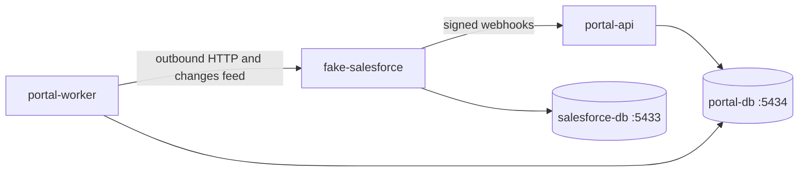

# Sync platform

Two-way sync demo between a portal and a Fake Salesforce stand-in. `portal-api` and `portal-worker` share the portal database. Fake Salesforce has its own database and talks to the portal only over HTTP.

Node.js 22 or newer. pnpm 12.

## Local setup

```text
docker compose up -d --wait
copy .env.example .env
pnpm install
pnpm --filter portal-api db:migrate
pnpm --filter fake-salesforce db:migrate
pnpm --filter portal-api db:seed
pnpm --filter fake-salesforce db:seed
pnpm dev
```

`portal-api` listens on `PORTAL_HTTP_PORT` (3000). Fake Salesforce listens on `SALESFORCE_HTTP_PORT` (3001). The worker has no HTTP server. It polls the portal outbox and the Fake Salesforce changes feed.

One process at a time:

```text
pnpm --filter portal-api dev
pnpm --filter portal-worker dev
pnpm --filter fake-salesforce dev
```

Checks:

```text
pnpm lint
pnpm format:check
pnpm test
pnpm test:e2e
pnpm build
pnpm ci
docker compose config
docker compose down
```

`pnpm test` runs unit tests. `pnpm test:e2e` creates `portal_e2e` and `salesforce_e2e` on the same Postgres instances, applies migrations, and runs the scenario suite. `pnpm ci` is lint, format, unit tests, e2e, and build. Apply migrations before the unit tests that read `portal-db`:

```text
pnpm --filter portal-api db:migrate
pnpm --filter fake-salesforce db:migrate
```

Each `db:migrate` applies only that app's `prisma/migrations` directory. The worker uses the portal database and does not own a migration directory.

## Architecture



Portal writes commit the record, field history, and an outbox row in one transaction. The worker delivers that row to Fake Salesforce and spends one token from the shared budget. Fake Salesforce posts a signed webhook back to the portal. The same inbound path accepts those webhooks and the reconciliation changes feed. A dropped webhook is recovered from the changes cursor, not by sending the payload again outside that path.

## Local dashboard

With `pnpm dev` running, open [http://localhost:3000/dashboard](http://localhost:3000/dashboard).

The page is static HTML served by `portal-api`. It creates and edits portal contacts through `/api/v1`, creates and edits Fake Salesforce contacts through `/sf/v1`, and replaces the simulator config with `PUT /simulator/config`. Outage is the `outageEnabled` checkbox. Duplicate count is the extra copies field. Reorder posts event ids to `/simulator/reorder-deliveries`. Refresh reads sync health (including `checkpointCursor`), the outbox, portal contact history, and webhook deliveries. The page does not apply conflict rules, sign webhooks, or move the reconciliation cursor.

Fake Salesforce allows browser calls from `localhost` and `127.0.0.1` only when `NODE_ENV` is not `production`. Set the actor, simulator token, and Fake Salesforce base URL at the top of the page. The default token is `local-simulator-token`.

History reads are `GET /api/v1/contacts/:id/history` and `GET /api/v1/customers/:id/history`. `limit` defaults to 50 and accepts 1 through 100. `after` is the previous page's `nextCursor`. Rows are ordered by `appliedAt`, then `id`.

## HTTP

Local actor header for portal data and sync routes: `x-actor-id`. Responses echo `x-correlation-id`.

| URL                                             | What it does                                                                                                               |
| ----------------------------------------------- | -------------------------------------------------------------------------------------------------------------------------- |
| `GET /health/live`                              | Process is up. Does not touch a database.                                                                                  |
| `GET /health/ready`                             | `SELECT 1` on that process's database. 503 when the database is unreachable. Lag does not fail readiness.                  |
| `GET /sf/v1/health`                             | Fake Salesforce process and database. It does not spend the simulator rate limit.                                          |
| `GET /api/v1/sync/health`                       | Outbox backlog, oldest age, reconciliation lag, dead-letter count, cursor, and whether portal state shows a recent worker. |
| `GET /api/v1/sync/metrics`                      | The named sync measurements.                                                                                               |
| `GET /api/v1/sync/outbox?status=DEAD`           | Up to 100 outbox rows. `status` is optional.                                                                               |
| `POST /api/v1/sync/outbox/{operationId}/replay` | Moves one `DEAD` row back to a due `RETRY`.                                                                                |
| `POST /api/v1/sync/reconciliation/runs`         | Inserts a request. The worker runs one pass on its next loop. The request does not move the cursor.                        |

Swagger:

| Process         | JSON                                 | UI                           |
| --------------- | ------------------------------------ | ---------------------------- |
| portal-api      | `http://localhost:3000/openapi.json` | `http://localhost:3000/docs` |
| fake-salesforce | `http://localhost:3001/openapi.json` | `http://localhost:3001/docs` |

The UI page lists the paths without a network connection. The interactive Swagger UI loads its browser assets from unpkg.

## curl

```text
curl http://localhost:3000/health/live
curl http://localhost:3000/health/ready
curl http://localhost:3001/health/ready
curl http://localhost:3001/sf/v1/health
curl http://localhost:3000/openapi.json
curl http://localhost:3001/docs

curl -H "x-actor-id: dev-user" http://localhost:3000/api/v1/sync/health
curl -H "x-actor-id: dev-user" http://localhost:3000/api/v1/sync/metrics
curl -H "x-actor-id: dev-user" "http://localhost:3000/api/v1/sync/outbox?status=DEAD"
curl -H "x-actor-id: dev-user" -X POST http://localhost:3000/api/v1/sync/outbox/OPERATION_ID/replay
curl -H "x-actor-id: dev-user" -X POST http://localhost:3000/api/v1/sync/reconciliation/runs
```

Create a customer:

```text
curl -H "x-actor-id: dev-user" -H "content-type: application/json" -H "Idempotency-Key: 11111111-1111-4111-8111-111111111111" -d "{\"name\":\"Ada\"}" http://localhost:3000/api/v1/customers
```

A live portal API does not mean the worker process is running. `workerObserved` on sync health is true when the portal database has a recent checkpoint, reconciliation completion, outbox touch, or an open outbox lease. The window is 30 seconds. It is not a heartbeat from the worker process.

## Databases

`infra/docker-compose.yml` starts two PostgreSQL 16 instances. They do not share a user, database, host port, volume, or Docker network.

| Service       | Host port | User       | Database   | Volume             |
| ------------- | --------- | ---------- | ---------- | ------------------ |
| portal-db     | 5434      | portal     | portal     | portal-db-data     |
| salesforce-db | 5433      | salesforce | salesforce | salesforce-db-data |

The passwords in `.env.example` and the compose file are for this local Docker setup.

## Limits

This demo does not delete or merge records, and it does not implement production OAuth, mTLS, or HMAC secret rotation. The webhook JSON is the demo envelope, not a Salesforce Platform Event or change-data-capture schema. Echo detection uses the simulator field `originOperationId`.

The shared outbound budget defaults to 80 requests per second so it stays under the fake server's 100 requests per second cap. Reconciliation reads and retries spend that same budget. The two-hour catch-up figure in the spec is an example under stated assumptions, not a committed service level. Outages are outside the normal latency target.

Replay is a database transition from `DEAD` to a due `RETRY` in one transaction. It does not call Fake Salesforce itself and it does not insert a second outbox row. A row that is not `DEAD` is left unchanged and the call returns 409. The previous `last_error` stays until the worker's next attempt replaces it. A second replay of the same row does not send twice.

The reconciliation route inserts `sync_commands` with status `PENDING`. The worker claims that row on its one-second loop, runs the existing pass under the same advisory lock, and moves the changes cursor only after a page commits. Calling the route while the worker is stopped leaves the row pending and leaves the cursor where it is.

Sync inspection routes use the local actor header and a per-process limit of 10 requests per second (`SYNC_ADMIN_REQUESTS_PER_SECOND`). That limit is not the Salesforce token bucket. Webhook duplicate and invalid-signature counters live in the portal API process and reset when that process restarts. Outbox age, dead-letter count, retry totals, and the latency histogram are read from portal tables. `outbound_retry_total` groups `attempts - 1` by the current `last_error`. `dead_letter_total` is the number of `DEAD` rows, so a successful replay decreases it. Reconciliation lag uses the portal checkpoint and the latest run. It does not read the Salesforce database.

Logs include `correlationId`, and `operationId` or `eventId` on the lines that have them. They do not include email, phone, full name, or changed-field values. The outbox inspection response does include `changedFields` for an operator. Do not log that response.

Several names and limits are still open product decisions: header names, the admin limit, whether the worker should grow an HTTP server, the exact metric exposition, and the reconciliation route staying a request row rather than an in-process call. The behavior above is the working binding for this demo.

Simulator admin routes are local only. They answer 404 when `NODE_ENV` is `production`. `POST /simulator/reset` deletes Fake Salesforce data.

## Troubleshooting

1. `GET /health/ready` on the process that looks stuck. 503 means that process cannot run `SELECT 1`.
2. `GET /api/v1/sync/health`. A rising `outboxPending` or `outboxOldestAgeSeconds` means the worker is behind or stopped. `workerObserved: false` means portal state has no recent worker evidence.
3. `GET /sf/v1/health` and Fake Salesforce `GET /health/ready`. A failure there is a remote outage. A simulator outage flag fails mutating `/sf/v1` calls and does not fail `/sf/v1/health`.
4. `GET /api/v1/sync/metrics` and look at `external_api_request_rate`, `outbound_retry_total`, and `reconciliation_lag_seconds`. A `429` from Fake Salesforce freezes the shared budget until `Retry-After` passes.
5. `GET /api/v1/sync/outbox?status=DEAD`. `last_error` of `http_404` or another `http_4xx` value stays dead until the remote record exists again. Then `POST` the replay URL for that `operationId` and let the worker flush.
6. Restart `portal-worker` if the process is gone. Restarting it runs a catch-up pass. It does not skip the cursor.
7. `POST /api/v1/sync/reconciliation/runs` when a webhook may have been dropped. The cursor advances only after the worker commits the page. `GET /api/v1/sync/health` shows `checkpointCursor`.
8. A webhook `401` with `invalid_signature` means the raw body and `WEBHOOK_HMAC_SECRET` do not match. The portal writes nothing for that request.
9. Do not call `POST /simulator/reset` to clear a stuck portal row. It deletes Fake Salesforce records and the next replay will see another `404`.
