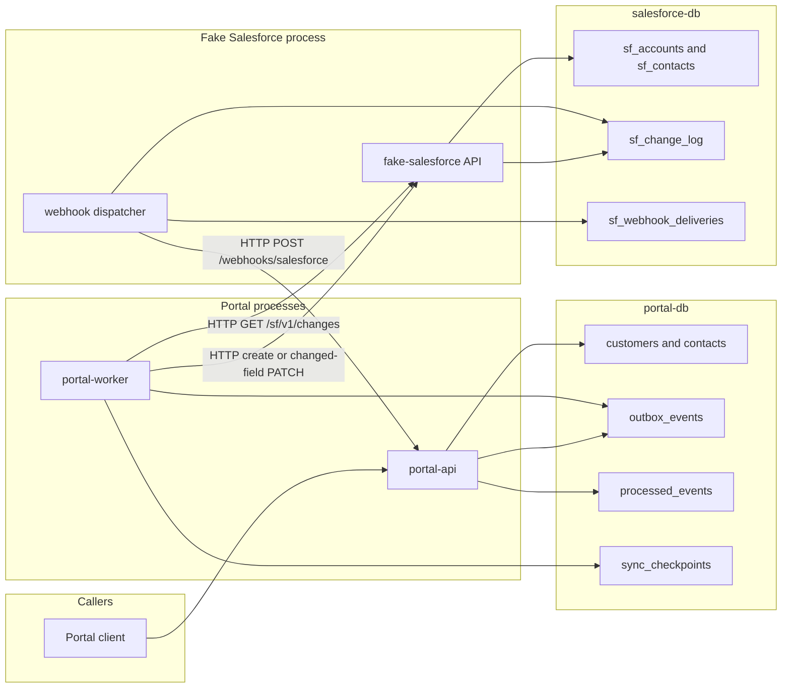
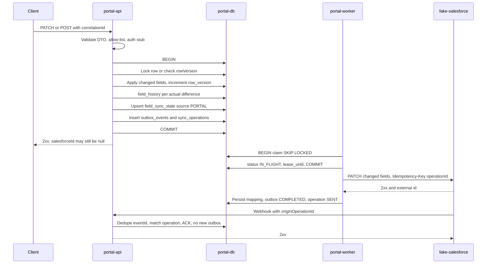
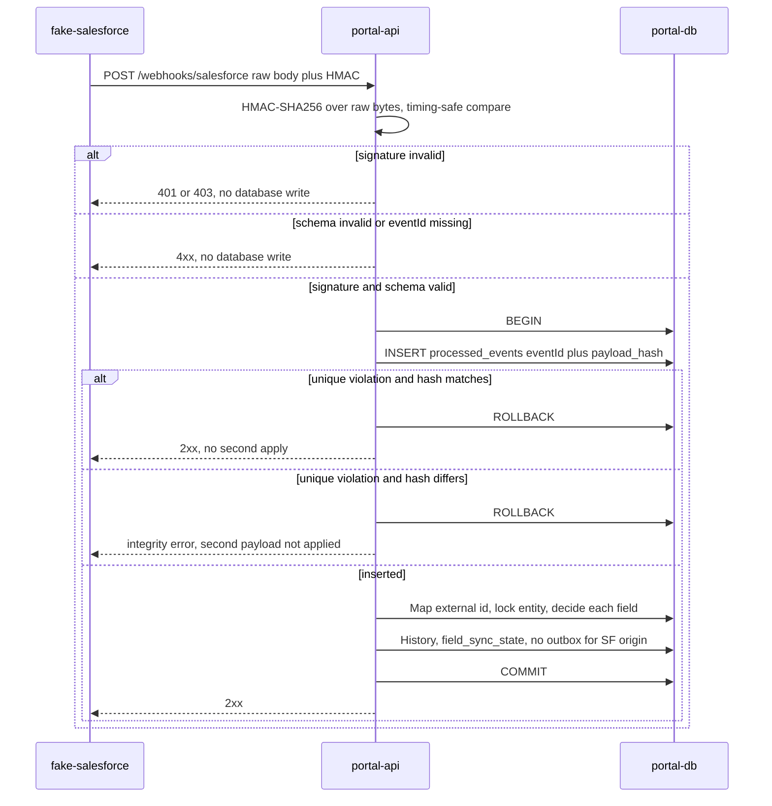

# Architecture

Derived from `docs/project-spec.md`. That file remains the requirements source. This document is the design map named beside it in the working agreement. If the two conflict, the spec wins until an ADR amends the spec. Items marked **Assumption** are not guarantees. Items marked **Open** are recorded in [Open decisions](#open-decisions).

MVP scope is bidirectional create and update of Customer/Account and Contact between the Tequity Portal and a Fake Salesforce server. Delete, merge, production Salesforce authentication, and a frontend are out of scope.

## System context

One pnpm monorepo. Three independently runnable NestJS processes. Two PostgreSQL 16+ databases. Portal code never reads or writes `salesforce-db`. Fake Salesforce never reads or writes `portal-db` and does not import portal persistence modules. Integration is HTTP in both directions.

```text
Portal client -> portal-api -> portal-db
                     | atomic outbox write
                     v
                portal-worker --HTTP--> fake-salesforce API -> salesforce-db
                     ^                         |
                     |                         v
            portal webhook API <--HTTP-- webhook dispatcher
                     ^
                     |
            reconciliation --HTTP GET /sf/v1/changes?after=cursor--> fake-salesforce
```

| Process | Role | Database |
| --- | --- | --- |
| `apps/portal-api` | Customer/Contact HTTP, inbound webhook, sync visibility | `portal-db` only |
| `apps/portal-worker` | Outbound delivery, lease reclaim, startup and periodic reconciliation | `portal-db` only |
| `apps/fake-salesforce` | Account/Contact HTTP, append-only change log, signed webhook dispatcher, simulator controls | `salesforce-db` only |

Shared libraries named by the spec:

| Package | Allowed contents | Forbidden |
| --- | --- | --- |
| `packages/contracts` | DTOs, webhook envelope, shared types | Database entities, Prisma clients, either app's persistence module |
| `packages/test-utils` | Deterministic clocks, fixture factories | Production-only dependencies |

**Open OD-SHARE.** `portal-api` and `portal-worker` both use `portal-db`. The spec does not name a shared persistence package. Sharing portal persistence inside the monorepo is allowed. Fake Salesforce must not import it. Adding a package beyond `contracts` and `test-utils` needs an ADR.



## Technology choices fixed by the spec

| Topic | Choice |
| --- | --- |
| Runtime | Node.js 22 LTS, or the supported current LTS |
| Services | NestJS, TypeScript strict |
| Data | PostgreSQL 16+, Prisma, plus SQL migrations where Prisma cannot express row locks or partial indexes |
| Workspaces | pnpm |
| Local topology | Docker Compose with separate `portal-db` and `salesforce-db` |
| Tests | Jest, Supertest, injected clock, deterministic simulator controls |
| HTTP docs | OpenAPI JSON and Swagger UI on both HTTP servers |
| Validation | class-validator DTOs |
| Logs | pino, `correlationId` on every log line |
| Tracing | OpenTelemetry optional |
| HTTP client | `@nestjs/axios` or `fetch`, with an explicit timeout |
| Time | ISO 8601 UTC |
| Identity | UUID inside the portal; distinct external Salesforce ids (`TEXT`) |
| Quotas | Integer tokens, including any fractional rate scaled to integers |
| Queue of record | PostgreSQL outbox. An in-memory queue is not the source of truth |

**Decision D1**, detailed in [ADR 0002](adr/0002-transactional-outbox.md): no Redis in the MVP. PostgreSQL polling is the worker mechanism. Redis may be introduced later only as an optimization, with an ADR.

Host ports, image tags, and environment variable names are deployment details. The spec requires independent environment variables, separate database credentials, and secrets only from the environment. It does not name the variables. **Open OD-ENV.**

## Domain mapping

| Portal | Fake Salesforce | Cardinality |
| --- | --- | --- |
| Customer | Account | One customer, many contacts |
| Contact | Contact | `customerId` required; the local customer row must exist |

Stable object mapping: external `Account` → `Customer`, external `Contact` → `Contact`. External ids are unique per object when present. `salesforce_id` stays null until the outbound create is acknowledged.

Synchronized fields:

| Entity | Fields written by sync |
| --- | --- |
| Customer | `name`, `status`, `ownerId` |
| Contact | `fullName`, `phone`, `email`, `city`, `ownerId`, customer reference |

Unknown fields are rejected. PATCH semantics: an absent field is unchanged; JSON `null` clears a field only when that field is nullable.

**Open OD-NULL.** The spec states `customers.name` is `NOT NULL` and `contacts.customer_id` is `NOT NULL`. It does not list nullability for `status`, `ownerId`, `fullName`, `email`, `phone`, or `city`. It does not define a `status` vocabulary or an email syntax rule.

**Open OD-OWNER.** "Validate ownership of mutable fields" is ambiguous. Reading A: reject fields outside the table above and record `actorId`. Reading B: only the record owner may mutate. MVP authentication is a local stub, so reading B cannot be enforced against a real identity provider. The allow-list is normative either way.

`actorId` comes from a development authentication header in local mode only. A `changedBy` value in a portal request body is never an actor and never an authorization decision. Fake Salesforce stores `changedBy` on the change log and copies it into the webhook. The portal records it as audit context only.

## Identity and idempotency namespaces

**Decision D2.** These namespaces are separate. A value in one namespace does not dedupe another.

| Namespace            | Identifier                               | Store specified by the spec                                                                     |
| -------------------- | ---------------------------------------- | ----------------------------------------------------------------------------------------------- |
| Inbound webhook      | `eventId`                                | `processed_events.event_id` primary key, plus `payload_hash`                                    |
| Outbound operation   | `operationId`                            | `outbox_events.operation_id` unique; `sync_operations.operation_id` primary key                 |
| Client create        | client idempotency key                   | Required by §8.1 and scenario "Duplicate client create". No table is defined. **Open OD-IDEMP** |
| Remote create/update | `Idempotency-Key` carrying `operationId` | Required on worker requests. No Fake Salesforce table is defined. **Open OD-SF-IDEMP**          |
| Correlation          | `correlationId`                          | Required on every operation and log. No outbox column is defined. **Open OD-CORR**              |

Delivery semantics that follow from those rules:

| Hop                                                                   | Semantic                                                                            |
| --------------------------------------------------------------------- | ----------------------------------------------------------------------------------- |
| Local transaction that commits a real field change and its outbox row | One outbox row per committed change set                                             |
| Worker HTTP                                                           | At-least-once. The idempotency key makes a replay return the original remote result |
| Inbound `eventId`                                                     | At-least-once delivery, single apply when `eventId` and `payload_hash` match        |
| End to end                                                            | Not exactly-once. Crash windows resend the same operation id                        |

A retried portal PATCH whose fields already equal the committed row produces no field difference, no new history row, and no new outbox row.

## Component responsibilities

### portal-api

- Validates DTOs and the local auth stub.
- Commits entity changes, `field_history`, `field_sync_state`, `outbox_events`, and `sync_operations` in one database transaction.
- Returns after commit. It does not call Fake Salesforce on the request thread.
- Accepts `POST /webhooks/salesforce`, verifies HMAC, and runs the inbound handler.
- Serves sync visibility: outbox listing and sync health.
- Does not insert an outbox row for a Salesforce-originated field change.

### portal-worker

- Claims due outbox rows with `SELECT … FOR UPDATE SKIP LOCKED`, sets `IN_FLIGHT` and `lease_until`, commits, and only then performs HTTP.
- Applies one shared integer-token quota across replicas.
- Sends changed fields only. Sends a create only when a new external id is required.
- Holds a contact create as retryable while the parent customer `salesforce_id` is null. It does not collapse that create into a later update, and it does not drop distinct field changes.
- Before send, re-reads `field_sync_state` and open operations. It skips or supersedes an obsolete same-field outbound while keeping the audit trail.
- Reclaims leases with `lease_until` in the past.
- Runs reconciliation at startup, on an interval, and on a manual trigger. The trigger's route is **Open OD-ROUTES**.
- Shares the inbound apply function with the webhook so `eventId` dedupe covers both paths.

**Open OD-WORKER-HTTP.** The worker is specified as a NestJS application context. `/health/live` and `/health/ready` are required without a process binding. `GET /api/v1/sync/health` can be answered from `portal-db` by `portal-api`, including while the worker process is dead. API liveness is not worker liveness.

### fake-salesforce

- Owns Account and Contact records and a `BIGSERIAL` change log.
- Logs portal-originated writes and local writes to the same append-only log.
- Dispatches signed webhooks from the log. Delivery order may diverge from `changeSequence`. The log order does not change when deliveries are reordered.
- Simulator endpoints are test-only, require a test admin token, and are disabled in production mode.
- Tests use deterministic simulator controls. `failure_rate` is not a test oracle (**Decision D3**).

**Open OD-SF-AUTH.** The spec authenticates simulator control endpoints and the portal webhook. It does not authenticate `GET/POST/PATCH /sf/v1/*`. Local isolation is a demo assumption, not a security control for a shared network. Real Salesforce authentication is out of MVP scope.

## Portal-originated write



Transaction steps, in order, for an update that changes at least one field:

1. Validate DTO and authorization. Reject unknown fields before opening the transaction that writes sync state.
2. Begin a PostgreSQL transaction.
3. Lock the target row, or apply optimistic `rowVersion` when `If-Match` is supplied. **Selected within the spec's "lock or optimistic" option:** take `FOR UPDATE` on the entity row and, when `If-Match` is present, also require `row_version` equality. **Open OD-IF-MATCH** for the HTTP status on mismatch. `If-Match` is optional in the MVP and preferred as a requirement later.
4. Apply only changed fields. Increment `row_version` once per committed write.
5. Insert `field_history` for each actual difference. Source is `PORTAL`.
6. Upsert `field_sync_state` with source `PORTAL`, the new local version, and `source_changed_at` equal to the transaction timestamp in UTC.
7. Insert one `outbox_events` row whose `changed_fields` and `base_versions` are immutable after insert, with a new `operationId`. Insert `sync_operations` in the same transaction.
8. Commit.
9. Return. The worker sends later.

A create uses the same commit shape. The client idempotency key is claimed in that transaction so a replay does not insert a second row or a second remote create. Same key and same body: return the original record. **Open OD-IDEMP-BODY** for the same key with a different body. **Open OD-CREATE-HTTP** for `201` versus `200` on first create and on replay.

Contact create is legal locally as soon as the portal customer row exists. The contact outbox row stays due only after the customer `salesforce_id` is non-null. Until then it remains retryable (`PENDING` or `RETRY` with a future `next_attempt_at`). The spec has no `BLOCKED` status. Do not fold the contact create into the customer create, and do not fold a later field patch into a create that has not yet received an external id.

**Assumption.** Isolation is `READ COMMITTED` plus explicit row locks. The spec does not require `SERIALIZABLE`.

## Outbound worker

Claim, inside a short transaction, then release the lock before any network call:

```sql
SELECT id
FROM outbox_events
WHERE (status IN ('PENDING', 'RETRY') AND next_attempt_at <= now())
   OR (status = 'IN_FLIGHT' AND lease_until <= now())
ORDER BY next_attempt_at, id
FOR UPDATE SKIP LOCKED
LIMIT $batch;
```

Then set `status = 'IN_FLIGHT'`, `lease_until = now() + lease`, and increment `attempts`. Commit. HTTP happens after commit.

| Remote result               | Outbox outcome                                                                                                                      |
| --------------------------- | ----------------------------------------------------------------------------------------------------------------------------------- |
| 2xx                         | Persist external id on the entity and on `sync_operations`. Outbox `COMPLETED`. Operation `SENT` until the echo moves it to `ACKED` |
| Timeout, HTTP 408, HTTP 5xx | `RETRY`, `next_attempt_at` from exponential backoff with jitter                                                                     |
| HTTP 429                    | `RETRY`, honor `Retry-After`                                                                                                        |
| Permanent 4xx               | `DEAD`, `last_error` set                                                                                                            |
| Worker dies after claim     | Row stays `IN_FLIGHT` until `lease_until`. Another worker reclaims it                                                               |

**Open OD-4XX.** The spec classifies timeout, 5xx, and 429 as retryable, and permanent 4xx as `DEAD`. It does not list 408, 404, or 409 individually. 429 is retryable even though it is a 4xx.

**Open OD-TIMING.** Lease length, poll interval, backoff base, cap, jitter range, and HTTP timeout are unnamed. The lease must outlive a single HTTP attempt so a live worker is not reclaimed mid-call. A reclaim that does happen is safe because the remote call carries the same `operationId`.

**Open OD-ATTEMPTS.** No maximum attempt count is specified. Repeated 5xx does not by itself move a row to `DEAD`.

**Open OD-SUPERSEDE.** Before send, if a newer committed portal change owns the same field, do not send the stale snapshot. The spec does not add a `SUPERSEDED` status. The audit trail remains. Distinct fields in the older row that are still current are still sent. A create without an external id is never discarded because a later update exists.

**Open OD-QUOTA.** One shared quota spans worker replicas. Decimal rates use integer tokens. No quota table is in §5. Replica-local counters do not satisfy the requirement. The limit is global, not per replica. On an empty bucket the worker reschedules the row and does not mark it `DEAD`.

**Open OD-RETRY-AFTER.** `Retry-After` delay-seconds versus HTTP-date is unspecified. The worker honors whichever form the implementation documents, and that form is part of the Fake Salesforce contract once chosen.

Supersede check and send race: the worker re-reads sync state after the lease commit and before HTTP. A portal write that commits during the HTTP call can make the response stale. The echo and the conflict policy cover that window. The in-flight request is not cancelled.

## Inbound webhook and reconciliation apply

Both the webhook and reconciliation call one handler.



Rules:

- HMAC-SHA256 is computed over the raw request bytes with the shared secret. Comparison is timing-safe. A canonicalized or re-serialized JSON body is not the signed input.
- `eventId` is mandatory.
- Duplicate `eventId` with the same `payload_hash`: acknowledge with 2xx and do not reapply.
- Duplicate `eventId` with a different `payload_hash`: security and integrity error. The second payload is not applied. **Open OD-HASH-HTTP** for the status code.
- The `processed_events` insert, field decisions, history, and sync-metadata updates commit together. A failure rolls the insert back so the delivery can retry. Optional failure diagnostics live in a separate transaction. The spec does not name that diagnostics table.
- Retryable processing failure returns non-2xx.
- Salesforce-originated applies do not insert `outbox_events`.
- Unknown external id: fetch the source record, create a local mapping, or defer until the parent mapping exists. No silent drop. **Open OD-UNKNOWN.** Recommended reading of §8.3 plus the test matrix: an unknown Account is fetched and inserted locally; a Contact whose Customer mapping is missing is deferred by rolling back `processed_events` and returning non-2xx, so webhook retry and reconciliation remain responsible for it.
- A deferred or failed event must not advance the reconciliation cursor.

**Open OD-PROC-STATUS.** Durable `PROCESSING` is not required: the spec rolls the insert back on failure and commits it on success. `APPLIED` and `IGNORED` are both legal committed statuses. `FAILED` fits a terminal integrity outcome stored so a retry of the bad payload does not become a successful apply. The exact mapping is open. This document's working rule: commit `APPLIED` when at least one field decision is `APPLIED`; commit `IGNORED` when every evaluated field is `NOOP`, `REJECTED_STALE`, or `CONFLICT_LOST`; use `FAILED` only when the event must not be retried as a new apply.

Stale rejection and conflict loss are completed processing. They commit and return 2xx so the sender does not treat them as lost deliveries.

### Reconciliation cursor

1. Read `sync_checkpoints` for the stream.
2. `GET /sf/v1/changes?after={cursor}&limit=N`. `after` is exclusive. The change-log primary key is the order.
3. Apply each event with the inbound handler, in `changeSequence` order.
4. Advance `cursor` to the last sequence on the page only after every event on that page has committed.
5. A crash after some events commit and before the checkpoint updates is recovered by replaying the page. Applied `eventId`s ack without a second mutation. The checkpoint then advances.

An empty page does not move `cursor`. **Open OD-EMPTY** whether `last_success_at` is updated.

A poison event that never commits blocks the checkpoint. The spec does not define a skip. Skipping by editing `sync_checkpoints` drops every later event on that page from the cursor contract and can lose data. The runbook forbids that edit unless an operator explicitly accepts the loss.

Startup reconciliation and a manual trigger are required. They use this cursor. They do not build a second apply path.

If a remote system cannot provide a durable ordered replay or modified-since feed, missed webhooks are not recoverable. That limit is binding for real Salesforce and is not true of this fake server while it retains `sf_change_log`.

## Conflict policy and ordering

Normative statement is [ADR 0003](adr/0003-conflict-policy.md). Algorithm:

| Situation                                                                                             | Rule                                                                                                           |
| ----------------------------------------------------------------------------------------------------- | -------------------------------------------------------------------------------------------------------------- |
| Same source, same record, same field, incoming `recordVersion` greater than the stored source version | Apply the field                                                                                                |
| Same source, same field, incoming `recordVersion` less than or equal to the stored source version     | Do not change the stored value. History decision `REJECTED_STALE`                                              |
| Same source, other fields on an older event that are not stale                                        | Evaluate those fields independently. `changedFields` is required because a record version does not name fields |
| Portal and Salesforce changed different fields                                                        | Keep both                                                                                                      |
| Portal and Salesforce changed the same field, `sourceChangedAt` differs                               | The later UTC timestamp wins                                                                                   |
| Same field, `sourceChangedAt` exactly equal                                                           | Salesforce wins                                                                                                |
| `recordVersion` from portal `row_version` and Salesforce `version`                                    | Not comparable. Never order a cross-system conflict by those numbers                                           |

Same-source order uses `recordVersion`, including when the older version carries a later timestamp. Cross-source order uses `sourceChangedAt` and the tie-break. Compare timestamps at stored precision. Truncating before compare can change a tie into a win.

Each evaluated inbound field appends `field_history` with the winning or rejected candidate: `APPLIED`, `REJECTED_STALE`, `NOOP`, or `CONFLICT_LOST`.

This is a demo policy. The two systems do not share a clock. Skew can make an earlier human edit win. A production design uses per-source version tokens and an explicit ownership or conflict policy. It does not reuse this tie-break as a claim about real Salesforce.

**Open OD-SAME-VER.** Two different `eventId`s, one source, one field, equal `recordVersion`, different values: the spec does not say which value survives.

## Echo suppression

The worker sends `operationId`. Fake Salesforce stores it as `origin_operation_id` and puts `originOperationId` on the webhook when the write came from the portal.

On inbound:

1. If `originOperationId` matches `sync_operations`, compare the external record id and the field values with `expected_values`.
2. When they match, set the operation to `ACKED` and do not insert an outbox row.
3. Still update source-version and ack metadata so a later same-source event can be ordered.
4. A matched echo does not exempt a field from staleness checks against a newer local value. Verification failure falls through to the conflict policy. **Open OD-ECHO** for the exact `field_sync_state.source` write, because one `source` column cannot record portal origin and Salesforce `recordVersion` without an extra column the spec does not define.

Value equality without an operation id is not echo detection. The spec's real-Salesforce fallback is bounded matching of pending operations on field and value, plus reconciliation. That fallback is documented and is not an MVP requirement of the fake server, which does emit `originOperationId`.

## Failure paths

| Id  | Condition                                              | Persistence                                               | Response                               | Retry                                                                         | Loss if the rules above are kept                                                                                        |
| --- | ------------------------------------------------------ | --------------------------------------------------------- | -------------------------------------- | ----------------------------------------------------------------------------- | ----------------------------------------------------------------------------------------------------------------------- |
| F1  | Portal database down during a user write               | No commit                                                 | 5xx                                    | Client may retry                                                              | No partial outbox                                                                                                       |
| F2  | Process dies after commit, before HTTP response        | Outbox row exists                                         | Client may see a timeout               | Create retry uses the client key. PATCH retry with the same values is a no-op | No second remote create when the create key is honored                                                                  |
| F3  | Worker dies after lease commit, before HTTP            | `IN_FLIGHT` until `lease_until`                           | None to the original client            | Reclaim and send                                                              | No                                                                                                                      |
| F4  | Remote commit succeeds, worker dies before `COMPLETED` | Lease expires                                             | None                                   | Resend same `operationId`                                                     | No, when the remote honors the key                                                                                      |
| F5  | Timeout, 5xx, 429                                      | `RETRY`                                                   | None to the original client            | Backoff, and `Retry-After` for 429                                            | No                                                                                                                      |
| F6  | Permanent 4xx                                          | `DEAD` plus `last_error`                                  | None to the original client            | Manual replay path. Route **Open OD-ROUTES**                                  | Remote lacks the change until replay. The dead letter is visible                                                        |
| F7  | Invalid HMAC                                           | No write                                                  | 401 or 403. **Open OD-SIG**            | Sender must not be treated as applied                                         | No                                                                                                                      |
| F8  | Missing `eventId` or malformed body                    | No write                                                  | 4xx                                    | Sender may fix and use a new id                                               | No                                                                                                                      |
| F9  | Same `eventId`, same hash                              | No second apply                                           | 2xx                                    | None                                                                          | No                                                                                                                      |
| F10 | Same `eventId`, different hash                         | Second payload not applied                                | Integrity error. **Open OD-HASH-HTTP** | Do not apply the differing body                                               | The first committed payload stands                                                                                      |
| F11 | Handler throws after insert, before commit             | Full rollback of that transaction                         | non-2xx                                | Webhook or reconciliation retries                                             | No                                                                                                                      |
| F12 | Parent mapping missing                                 | No successful `processed_events` commit on the defer path | non-2xx                                | Later retry once the parent exists                                            | No silent drop. A never-arriving parent retries until an operator intervenes. No inbound dead-letter table is specified |
| F13 | Older same-source field version                        | Current value kept, `REJECTED_STALE`                      | 2xx                                    | Not a failure                                                                 | The older value is retained in history only                                                                             |
| F14 | Webhook dropped                                        | `sf_change_log` row remains                               | Delivery not 2xx                       | Reconciliation from cursor                                                    | No, while the fake log is retained. Unrecoverable on a remote API without replay                                        |
| F15 | Fake Salesforce outage                                 | Portal commit and outbox growth                           | Portal 2xx                             | Drain after recovery                                                          | No portal write loss. Inbound changes during the outage depend on the change log                                        |
| F16 | Reconciliation crash before checkpoint                 | Page events that committed stay applied                   | None                                   | Replay page, then move cursor                                                 | No                                                                                                                      |
| F17 | Poison change-log event                                | Cursor stays at the previous page                         | Run does not succeed                   | Operator fixes the event. Cursor is not hand-advanced                         | Events after the poison row stay unapplied until the page commits                                                       |
| F18 | Shared quota empty                                     | Row rescheduled                                           | None                                   | Later claim                                                                   | No                                                                                                                      |
| F19 | Clock skew on a cross-source tie or ordering           | The demo policy still picks a winner                      | 2xx                                    | None                                                                          | The later real-world edit can lose. History shows both candidates                                                       |

Loop prevention is the combination of F13's inbound path (no outbox on Salesforce origin) and echo suppression (no outbox on a verified `originOperationId`).

## Capacity, quota, and recovery math

Normal-operation target: a committed change is visible in the other system within 30 seconds. Internal target: under 10 seconds at p95. p95 and p99 are monitored. The spec sets no numeric p99 target (**Open OD-SLO**). Outage intervals are outside the normal target and use a separate catch-up objective. The spec does not set a numeric catch-up SLO.

Worked example from the spec, outbound only:

```text
backlog_operations = 20 ops/s × 6 h × 3600 s/h = 432,000
external_limit    = 100 requests/s
reserved_other    = 20 requests/s
outbound_budget   = 100 − 20 = 80 requests/s
continuing_writes = 20 ops/s
net_drain         = 80 − 20 = 60 ops/s
catch_up          = 432,000 / 60 = 7,200 s = 2 h
```

The arithmetic assumes one request per operation, no coalescing, and no retries. The shared limit is global across worker replicas. Those three assumptions are part of the example, not extra safety margin.

```text
net_drain = outbound_budget − continuing_arrival_rate
catch_up_seconds = backlog_operations / net_drain    when net_drain > 0
```

When `net_drain <= 0`, the backlog does not shrink. Raising replicas does not raise a global limit.

The example leaves retry amplification and reconciliation volume inside the 20 requests/s reserve and does not measure them. Each retry is another request against the same global limit. Each reconciliation page is another request. If those together exceed the reserve, they reduce the 80 requests/s outbound budget and the 2 hour figure no longer holds. The 2 hour figure is an illustrative worst case under the stated assumptions. It is not a committed catch-up SLO (**Open OD-SLO**).

The 100 requests/s and 20 requests/s figures are example inputs. Product defaults are configuration. Fake Salesforce `rate_limit_per_sec` is the simulator's remote cap. The portal quota must be configured against that cap with headroom for reconciliation and retries. **Open OD-QUOTA-SPLIT** for the configured split. Do not hard-code the example as the only legal configuration.

Inbound events missed during the outage are not part of the 432,000. They drain through the changes cursor and consume reconciliation headroom.

## Observability

Metric names from the spec:

| Metric                               | Reads                                                                                                                                                                    |
| ------------------------------------ | ------------------------------------------------------------------------------------------------------------------------------------------------------------------------ |
| `outbox_pending_total`               | **Assumption:** rows in `PENDING`, `IN_FLIGHT`, or `RETRY`                                                                                                               |
| `outbox_oldest_age_seconds`          | Oldest unfinished outbox row that is not `DEAD`                                                                                                                          |
| `sync_latency_seconds`               | Histogram. Normal-operation p95 target is under 10 seconds. Start and stop instants are not named by the spec                                                            |
| `webhook_duplicates_total`           | Same `eventId` and same hash                                                                                                                                             |
| `webhook_invalid_signature_total`    | Failed HMAC                                                                                                                                                              |
| `outbound_retry_total`               | Labeled by result status                                                                                                                                                 |
| `dead_letter_total`                  | Transition to `DEAD`                                                                                                                                                     |
| `reconciliation_lag_seconds`         | **Assumption:** age of the newest change-log row after the checkpoint, using `occurred_at`                                                                               |
| `reconciliation_discrepancies_total` | **Assumption:** applied pages that contained a non-`APPLIED` field decision or a repair of a missed webhook. The spec names the metric and does not define the increment |
| `external_api_request_rate`          | Portal calls to Fake Salesforce                                                                                                                                          |

**Open OD-METRICS.** Exposition format and which process publishes counters are unspecified. Gauges that are SQL queries against `portal-db` can be served by `portal-api`. In-process counters reset on restart. The spec does not require durable metrics.

Health:

| Endpoint                  | Specified role                                                                                                               |
| ------------------------- | ---------------------------------------------------------------------------------------------------------------------------- |
| `/health/live`            | Process liveness. Binding **Open OD-WORKER-HTTP**                                                                            |
| `/health/ready`           | Readiness. The spec does not say backlog fails readiness. **Assumption:** readiness is dependency connectivity, not sync lag |
| `GET /api/v1/sync/health` | Sync view over portal state                                                                                                  |
| `GET /sf/v1/health`       | Fake Salesforce process health                                                                                               |

Every log line includes `correlationId`. Logs omit plaintext PII. Request logs on the fake server store method, path, operation id, status, and latency, not bodies.

Retention and PII redaction are required before production and are undefined in the MVP (**Open OD-RETENTION**).

## Security assumptions

Specified controls:

| Control              | Rule                                                                                |
| -------------------- | ----------------------------------------------------------------------------------- |
| Webhook authenticity | Shared HMAC-SHA256 over raw bytes, timing-safe compare, secret from the environment |
| Integrity            | One `payload_hash` per `eventId`. A different hash is an integrity error            |
| Authorization stub   | Local development header supplies `actorId`. Body `changedBy` is ignored for auth   |
| Simulator            | Admin token, disabled in production mode, not part of the data-plane contract       |
| Databases            | Separate credentials, separate instances                                            |
| Timeouts             | Every outbound HTTP call has an explicit timeout                                    |
| Admin surface        | Rate-limited. Numeric limit **Open OD-ADMIN-LIMIT**                                 |
| Logs                 | Sanitized. No plaintext PII in request logs                                         |
| Secrets              | Environment only                                                                    |

Demo assumptions that are not security guarantees:

- The spec does not define mTLS, OAuth, JWT, webhook timestamp windows, or HMAC secret rotation (**Open OD-HMAC-ROTATION**). Identical-body replay is a supported delivery, deduped by `eventId`, not rejected as a signature replay.
- `/sf/v1` authentication is unspecified (**Open OD-SF-AUTH**).
- The portal auth header name is unspecified (**Open OD-HEADERS**).
- Network location of the simulator is a deployment concern. Production mode disables the control endpoints; it does not make them safe to expose.

## Real Salesforce limitations

These are limits of this design against production Salesforce. They are not defects in the fake server.

| Topic           | What this demo does                                                                                                                                                                           | What production Salesforce requires instead                                                                                                                           |
| --------------- | --------------------------------------------------------------------------------------------------------------------------------------------------------------------------------------------- | --------------------------------------------------------------------------------------------------------------------------------------------------------------------- |
| Webhook schema  | Envelope in [api-contracts](api-contracts.md), including `eventId`, `changedFields`, `changedBy`, and simulator fields `recordVersion`, `originOperationId`, `changeSequence` (assumption A1) | The actual event schema. This document does not claim Platform Events, CDC, or outbound messages match this JSON                                                      |
| Echo            | `originOperationId` is a simulator field                                                                                                                                                      | When the remote event has no operation id, use bounded pending-operation matching on field and value, plus reconciliation. Value equality alone is not echo detection |
| Replay          | `sf_change_log.sequence` is a durable ordered cursor retained for tests (assumption A3)                                                                                                       | The remote replay id, retention, and change-tracking API. If that mechanism is absent, dropped webhooks cannot be recovered reliably                                  |
| Versions        | Portal `row_version` and Salesforce `version` are per-database counters                                                                                                                       | They are not one sequence. Cross-system conflicts use the documented policy, not numeric comparison of those counters                                                 |
| Auth            | No Salesforce credentials                                                                                                                                                                     | Connected-app or equivalent org auth, named credentials, and API limits. Out of MVP                                                                                   |
| Rate limit      | The 100 requests/s figure is an example                                                                                                                                                       | The org's real limit. The recovery worksheet takes the real limit as an input                                                                                         |
| Data model      | Create and update of Account→Customer and Contact                                                                                                                                             | Delete, undelete, merge, and any other standard object are out of MVP                                                                                                 |
| Identity        | `TEXT` external ids. `SF-ACC-001` in examples is illustrative                                                                                                                                 | Salesforce id format and case rules are not modeled                                                                                                                   |
| Field writes    | PATCH, absent means unchanged, null clears nullable fields                                                                                                                                    | Field-level security, required-field rules, and null handling of the org can reject a payload this demo accepts                                                       |
| Conflict times  | `occurredAt` plus Salesforce-wins-ties                                                                                                                                                        | Independent clocks skew. Production should use source-specific version tokens and an ownership policy                                                                 |
| Change contents | `changedFields` is required                                                                                                                                                                   | A record-level modification stamp does not identify fields. A snapshot apply without field names can overwrite unrelated newer fields                                 |
| Admin API       | `/simulator/*`                                                                                                                                                                                | Not a Salesforce API. It must not be reachable in a production deployment                                                                                             |

Assumptions A1–A5 and decisions D1–D3 in the spec are accepted here and in the ADRs.

## Repository layout

```text
sync-platform/
  apps/portal-api/
  apps/portal-worker/
  apps/fake-salesforce/
  packages/contracts/
  packages/test-utils/
  infra/docker-compose.yml
  docs/architecture.md
  docs/database-design.md
  docs/api-contracts.md
  docs/test-matrix.md
  docs/runbook.md
  docs/adr/
```

Each app has its own migration directory and its own environment. Phase 0 in the spec is the workspace, Compose, and env examples. This document does not add runtime files.

## Open decisions

| Id               | Topic                                                             | Why it is open                                                                                                                                                        |
| ---------------- | ----------------------------------------------------------------- | --------------------------------------------------------------------------------------------------------------------------------------------------------------------- |
| OD-SHARE         | Where portal persistence code lives                               | No package is named; fake Salesforce must not import it                                                                                                               |
| OD-ENV           | Environment variable names                                        | Independent env is required; names are not                                                                                                                            |
| OD-NULL          | Nullable fields, `status` values, email syntax                    | Only some `NOT NULL` constraints are specified                                                                                                                        |
| OD-OWNER         | "Ownership" of mutable fields                                     | Allow-list versus record-owner authorization                                                                                                                          |
| OD-IDEMP         | Client create-key store                                           | Behavior is required; no table is specified                                                                                                                           |
| OD-IDEMP-BODY    | Same client key, different body                                   | Not specified                                                                                                                                                         |
| OD-SF-IDEMP      | Fake Salesforce idempotency store                                 | Worker key is required; no table is specified                                                                                                                         |
| OD-CORR          | Persisting `correlationId` for the worker                         | Required on the operation; no column is specified                                                                                                                     |
| OD-WORKER-HTTP   | Which process serves `/health/live` and `/health/ready`           | Worker is an application context; health routes are unbound                                                                                                           |
| OD-SF-AUTH       | Auth on `/sf/v1` data plane                                       | Unspecified                                                                                                                                                           |
| OD-IF-MATCH      | HTTP status when `If-Match` does not match                        | Header is optional; mismatch status is not given                                                                                                                      |
| OD-CREATE-HTTP   | Create and replay status codes                                    | Not given                                                                                                                                                             |
| OD-4XX           | Which 4xx values other than 429 are permanent                     | "Permanent 4xx" is stated; the exception list is only 429 plus timeouts                                                                                               |
| OD-TIMING        | Lease, poll, backoff, jitter, HTTP timeout, changes `limit` cap   | Behaviors are required; numbers are not                                                                                                                               |
| OD-ATTEMPTS      | Whether retries ever dead-letter without a 4xx                    | No max attempts in the spec                                                                                                                                           |
| OD-SUPERSEDE     | Terminal status of an obsolete outbox row                         | No `SUPERSEDED` value in the enum                                                                                                                                     |
| OD-QUOTA         | Physical store for the global integer token bucket                | Required; no table                                                                                                                                                    |
| OD-QUOTA-SPLIT   | Outbound versus reconciliation budget                             | The 80/20 split is an example                                                                                                                                         |
| OD-RETRY-AFTER   | `Retry-After` syntax                                              | Unspecified                                                                                                                                                           |
| OD-ROUTES        | Manual reconciliation and dead-letter replay routes               | Capabilities are required; paths are not in §7                                                                                                                        |
| OD-HASH-HTTP     | Status for `eventId` hash mismatch                                | Called an integrity error; code not given                                                                                                                             |
| OD-PROC-STATUS   | `APPLIED` / `IGNORED` / `FAILED` / `PROCESSING` mapping           | Enum is given; transitions are not                                                                                                                                    |
| OD-UNKNOWN       | Fetch, create, or defer for an unknown external id                | Both "fetch or defer" and "fetch/create/defer" appear                                                                                                                 |
| OD-EMPTY         | `last_success_at` on an empty changes page                        | Not specified                                                                                                                                                         |
| OD-SAME-VER      | Equal source version, different values, different event ids       | Not specified                                                                                                                                                         |
| OD-ECHO          | `field_sync_state` columns written on echo, and mismatch handling | Single `source` column; verify-and-ack is required                                                                                                                    |
| OD-SLO           | Numeric catch-up SLO and p99 target                               | 30s and p95 under 10s are the only numeric latency targets; 2h is illustrative                                                                                        |
| OD-METRICS       | Metric exposition                                                 | Names are specified; format and process are not                                                                                                                       |
| OD-RETENTION     | Retention and PII redaction schedule                              | Explicitly deferred to before production                                                                                                                              |
| OD-ADMIN-LIMIT   | Admin rate-limit numbers                                          | Required; values are not                                                                                                                                              |
| OD-HMAC-ROTATION | Secret rotation                                                   | Not specified                                                                                                                                                         |
| OD-HEADERS       | Header names for HMAC, correlation, dev actor                     | Algorithms and fields are specified; most header tokens are not. Worker idempotency is described as `Idempotency-Key` / `operationId`                                 |
| OD-SIG           | 401 versus 403 on a bad webhook signature                         | The spec allows either                                                                                                                                                |
| OD-ENVELOPE      | Dual `changedFields` shapes                                       | §7.3 shows a string array plus `values`. The assignment sample is an object plus `changedBy`. Both are accepted. The fake server emits the object form plus A1 fields |
| OD-REF           | Wire name of the contact's customer reference                     | Spec says "customer reference". Fake column is `account_id`                                                                                                           |
| OD-PAGE          | History cursor query names and page size                          | Cursor pagination is required; the query string is not                                                                                                                |
| OD-EXPIRES       | `sync_operations.expires_at`                                      | Column is specified; no sweeper or expiry effect is                                                                                                                   |
| OD-RECON-STATUS  | `reconciliation_runs.status` and delivery status values           | Columns are specified; vocabularies are not                                                                                                                           |
| OD-DISORDER      | `disorder_mode` vocabulary                                        | Column is specified; tests reorder deliveries explicitly                                                                                                              |
| OD-FK-DELETE     | Foreign-key `ON DELETE`                                           | Unspecified. Deletes are out of MVP                                                                                                                                   |

Working assumptions used so later phases have a single reading, without promoting them to spec guarantees:

| Id              | Working assumption                                                                                                                               |
| --------------- | ------------------------------------------------------------------------------------------------------------------------------------------------ |
| OD-SIG          | Respond `401` for a bad HMAC. Reserve `403` for a present but rejected simulator admin token                                                     |
| OD-HEADERS      | `Idempotency-Key` carries the client key or the `operationId`. Other header names stay open                                                      |
| OD-PROC-STATUS  | `APPLIED` if any field is `APPLIED`; otherwise `IGNORED` for a fully evaluated event; `FAILED` only for terminal integrity                       |
| OD-UNKNOWN      | Fetch and create a local Customer for an unknown Account. Defer a Contact when the Customer mapping is absent, with rollback and non-2xx         |
| OD-4XX          | Timeout and `408` and `429` and `5xx` retry. Other `4xx` values are `DEAD`                                                                       |
| OD-WORKER-HTTP  | `portal-api` and fake-salesforce serve `/health/live` and `/health/ready`. Worker health is the process plus database-visible lag                |
| OD-ECHO         | A verified echo acks the operation and updates remote version metadata without writing an outbox row and without overwriting a newer local field |
| OD-CREATE-HTTP  | First create `201`. Idempotent replay `200` with the original body                                                                               |
| OD-REF          | Wire name `accountId` on Contact events and Fake Salesforce JSON                                                                                 |
| OD-FK-DELETE    | `ON DELETE RESTRICT` on portal contacts and fake contacts                                                                                        |
| OD-RECON-STATUS | Runs: `RUNNING`, `SUCCEEDED`, `FAILED`. Deliveries: `PENDING`, `DELIVERING`, `DELIVERED`, `DROPPED`, `FAILED`                                    |

Phases and the definition of done are spec §12. They are not restated here.
