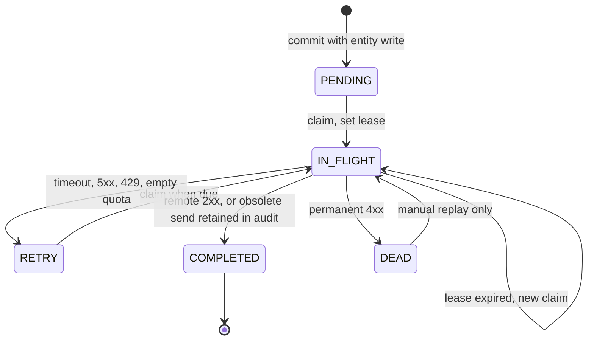
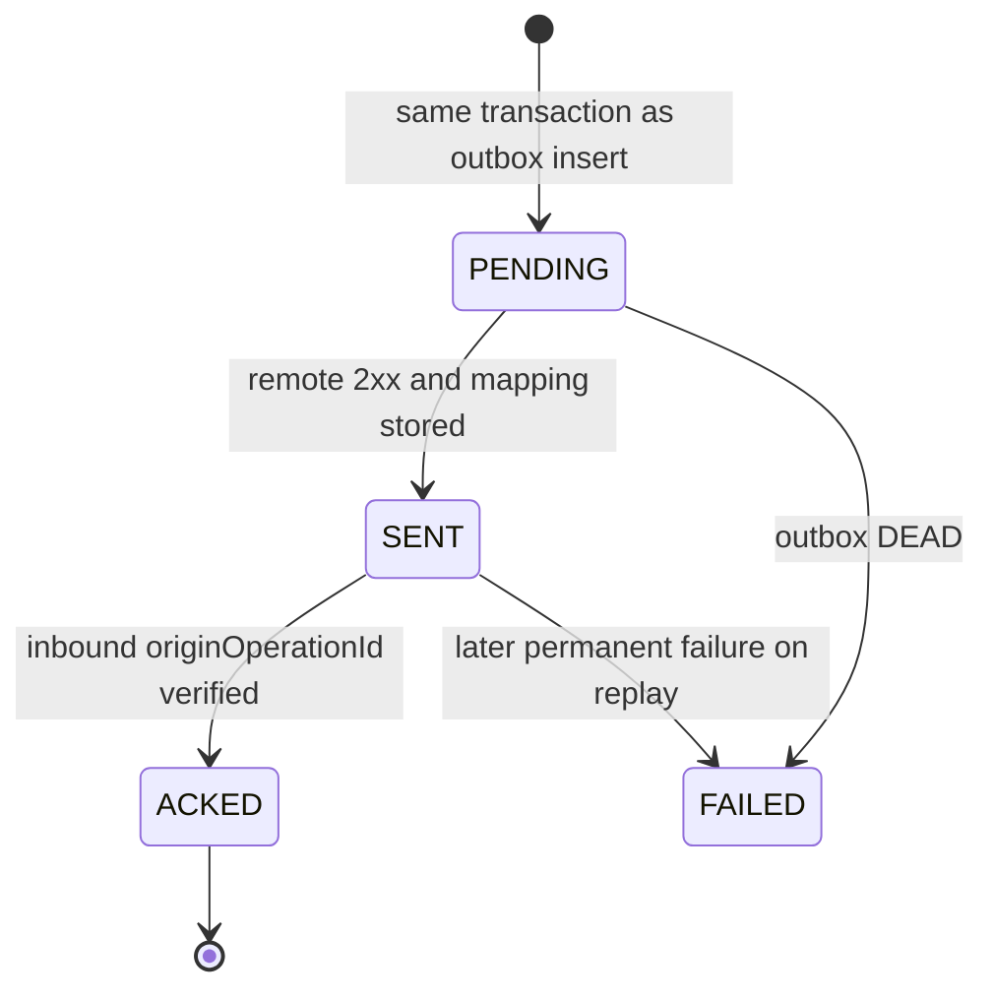

# Database design

Derived from `docs/project-spec.md` §5 and §6. Physical types below use PostgreSQL 16+. Prisma models the tables. SQL migrations own partial indexes, check constraints Prisma cannot express, and any index that must match a `FOR UPDATE SKIP LOCKED` claim. Application code uses transactions for every state change that also writes the outbox or `processed_events`.

Two databases, two migration directories, two credentials. No foreign keys, views, or dblink across them.

Identifiers: portal surrogate keys are UUID. Salesforce record ids are `TEXT` and are not UUIDs. Example values such as `SF-ACC-001` are illustrative. Timestamps are `TIMESTAMPTZ`, stored in UTC, serialized as ISO 8601 UTC. Versions that cross a process boundary stay integers in the database. `field_sync_state.source_version` is `TEXT` because portal `row_version` and Salesforce `version` are different sequences and must not share a numeric comparison operator.

JSON integers above `2^53-1` are unsafe in some clients. The spec does not require stringified bigints. MVP counters start at 0 and increment by 1 per write or per remote version bump.

## Portal database

### `customers`

| Column | Type | Null | Constraint |
| --- | --- | --- | --- |
| `id` | `UUID` | no | Primary key |
| `salesforce_id` | `TEXT` | yes | Unique. Multiple nulls are allowed, which is PostgreSQL unique behavior and matches "unique external id once mapped" |
| `name` | `TEXT` | no | Only mutable customer field the spec marks `NOT NULL` |
| `status` | `TEXT` | unspecified | **Open OD-NULL**. No enum in the spec |
| `owner_id` | `TEXT` | unspecified | **Open OD-NULL** |
| `row_version` | `BIGINT` | no | Default `0`. Increment by 1 on each committed mutating write |
| `created_at` | `TIMESTAMPTZ` | no | Set on insert |
| `updated_at` | `TIMESTAMPTZ` | no | Set on insert and on each committed mutating write |

| Index | Definition | Origin |
| --- | --- | --- |
| `customers_pkey` | `PRIMARY KEY (id)` | Spec |
| `customers_salesforce_id_key` | `UNIQUE (salesforce_id)` | Spec |

Lookup by external id for inbound mapping uses the unique index. The listed portal APIs fetch by primary key. A collection-list endpoint is not in §7.1. Cursor pagination for about 5 million customer and contact rows applies to history and to the Salesforce changes feed. It does not imply an unlisted list API.

### `contacts`

| Column | Type | Null | Constraint |
| --- | --- | --- | --- |
| `id` | `UUID` | no | Primary key |
| `salesforce_id` | `TEXT` | yes | Unique. Multiple nulls allowed |
| `customer_id` | `UUID` | no | References `customers(id)` |
| `full_name` | `TEXT` | unspecified | **Open OD-NULL** |
| `email` | `TEXT` | unspecified | **Open OD-NULL**. No unique constraint in the spec |
| `phone` | `TEXT` | unspecified | **Open OD-NULL** |
| `city` | `TEXT` | unspecified | **Open OD-NULL** |
| `owner_id` | `TEXT` | unspecified | **Open OD-NULL** |
| `row_version` | `BIGINT` | no | Same rule as customers |
| `created_at` | `TIMESTAMPTZ` | no |  |
| `updated_at` | `TIMESTAMPTZ` | no |  |

| Index | Definition | Origin |
| --- | --- | --- |
| `contacts_pkey` | `PRIMARY KEY (id)` | Spec |
| `contacts_salesforce_id_key` | `UNIQUE (salesforce_id)` | Spec |
| `contacts_customer_id_idx` | `INDEX (customer_id)` | Spec |

**Open OD-FK-DELETE.** `ON DELETE` is unspecified. Deletes are out of MVP. Use `ON DELETE RESTRICT` so a customer with contacts cannot disappear through an unscoped delete.

### `field_history`

Append-only audit of field decisions. One row per evaluated field outcome that the sync rules record.

| Column | Type | Null | Notes |
| --- | --- | --- | --- |
| `id` | `UUID` | no | Primary key |
| `entity_type` | `TEXT` | no | Portal types `customer` and `contact`. **Assumption:** these two values. The spec does not spell the string |
| `entity_id` | `UUID` | no | Portal id |
| `field_name` | `TEXT` | no | Allow-listed field |
| `old_value` | `JSONB` | yes | Previous value. JSON `null` is a clear |
| `new_value` | `JSONB` | yes | Candidate value, including a rejected candidate |
| `source` | `TEXT` | no | `PORTAL` or `SALESFORCE` |
| `actor_id` | `TEXT` | yes | From the local auth stub. Null when the caller is Salesforce |
| `event_id` | `TEXT` | yes | Inbound `eventId` when the decision came from a webhook or reconciliation |
| `operation_id` | `UUID` | yes | Outbound operation when the decision came from a portal write |
| `source_changed_at` | `TIMESTAMPTZ` | yes | Portal transaction time or inbound `occurredAt` |
| `applied_at` | `TIMESTAMPTZ` | no | Portal commit time |
| `decision` | `TEXT` | no | `APPLIED`, `REJECTED_STALE`, `NOOP`, `CONFLICT_LOST` |

| Index | Definition | Origin |
| --- | --- | --- |
| `field_history_pkey` | `PRIMARY KEY (id)` | Spec |
| `field_history_entity_applied_idx` | `(entity_type, entity_id, applied_at)` | Spec |

History reads for one entity are `WHERE entity_type = $1 AND entity_id = $2 ORDER BY applied_at, id`. The unique tie-break is `id`, because `applied_at` alone can tie. The specified index supports the filter. **Assumption:** page size and cursor parameter names are **Open OD-PAGE**. A derived index `(entity_type, entity_id, applied_at, id)` is optional; the specified index remains mandatory.

Check: `decision IN ('APPLIED','REJECTED_STALE','NOOP','CONFLICT_LOST')` and `source IN ('PORTAL','SALESFORCE')`.

Portal writes insert a history row only when the stored value changes. Inbound processing inserts a history row for every changed field it evaluates, including rejected and no-op outcomes, so the losing candidate is visible. A duplicate `eventId` returns before this insert.

### `processed_events`

| Column | Type | Null | Notes |
| --- | --- | --- | --- |
| `event_id` | `TEXT` | no | Primary key. Unique is the primary key |
| `payload_hash` | `TEXT` | no | Hash of the raw body used for the HMAC. Algorithm for the hash itself is **Open** within OD-PROC-STATUS; SHA-256 of the raw bytes is the working assumption so it matches the HMAC input |
| `entity_type` | `TEXT` | yes | Known after parse. Null only if a future terminal failure stores a row before mapping. The success path fills it |
| `external_id` | `TEXT` | yes | Salesforce record id |
| `status` | `TEXT` | no | `PROCESSING`, `APPLIED`, `IGNORED`, `FAILED` |
| `received_at` | `TIMESTAMPTZ` | no |  |
| `processed_at` | `TIMESTAMPTZ` | yes | Set on committed outcome |

The inbound transaction inserts the row and, on success, commits `APPLIED` or `IGNORED` in that same transaction. A failure rolls the insert back. `PROCESSING` is the in-transaction status, not a state other workers observe after commit. **Open OD-PROC-STATUS.**

Same `event_id` and same `payload_hash`: the unique violation is an acknowledgement, not a second apply. Same `event_id` and different `payload_hash`: integrity error; the second payload does not change entity state.

### `outbox_events`

| Column | Type | Null | Notes |
| --- | --- | --- | --- |
| `id` | `UUID` | no | Primary key. Surrogate. Not the idempotency key |
| `operation_id` | `UUID` | no | Unique. Worker `Idempotency-Key` and webhook `originOperationId` |
| `entity_type` | `TEXT` | no | `customer` or `contact` |
| `entity_id` | `UUID` | no | Portal id |
| `event_type` | `TEXT` | no | **Assumption:** `created` or `updated` |
| `changed_fields` | `JSONB` | no | Immutable set of fields and values to send. Not a full-row snapshot |
| `base_versions` | `JSONB` | no | Versions observed at enqueue, used to detect a stale send. Shape **Assumption:** `{ "rowVersion": <number>, "fields": { "<field>": "<source_version>" } }` |
| `status` | `TEXT` | no | `PENDING`, `IN_FLIGHT`, `RETRY`, `COMPLETED`, `DEAD` |
| `attempts` | `INT` | no | Default 0. Incremented on each claim, including reclaim |
| `next_attempt_at` | `TIMESTAMPTZ` | no | Due time. New rows are due immediately. **Assumption** |
| `lease_until` | `TIMESTAMPTZ` | yes | Set while `IN_FLIGHT` |
| `last_error` | `TEXT` | yes | Last remote or supersede reason. Must not contain raw PII values beyond field names and status codes |
| `created_at` | `TIMESTAMPTZ` | no |  |
| `updated_at` | `TIMESTAMPTZ` | no |  |

| Index | Definition | Origin |
| --- | --- | --- |
| `outbox_events_pkey` | `PRIMARY KEY (id)` | Spec |
| `outbox_events_operation_id_key` | `UNIQUE (operation_id)` | Spec |
| `outbox_events_status_next_attempt_idx` | `(status, next_attempt_at)` | Spec |
| `outbox_events_due_idx` | `(next_attempt_at, id) WHERE status IN ('PENDING','RETRY')` | Derived partial index for the claim |
| `outbox_events_lease_idx` | `(lease_until) WHERE status = 'IN_FLIGHT'` | Derived partial index for reclaim |

A third derived partial index `(entity_type, entity_id) WHERE status IN ('PENDING','IN_FLIGHT','RETRY')` supports the supersede scan. It is not required by the spec text. Add it in the SQL migration when the supersede query is written.

There is no `BLOCKED` and no `SUPERSEDED` status. Parent-wait and obsolete-send stay inside the enum. **Open OD-SUPERSEDE.**



`correlation_id` is not a specified column. **Open OD-CORR.** Adding it is a schema change and needs to be explicit in the migration review. Overloading `changed_fields` with it is not allowed.

### `field_sync_state`

| Column              | Type          | Null | Notes                                           |
| ------------------- | ------------- | ---- | ----------------------------------------------- |
| `entity_type`       | `TEXT`        | no   | Composite primary key                           |
| `entity_id`         | `UUID`        | no   | Composite primary key                           |
| `field_name`        | `TEXT`        | no   | Composite primary key                           |
| `source`            | `TEXT`        | no   | `PORTAL` or `SALESFORCE`                        |
| `source_version`    | `TEXT`        | no   | Decimal text of that source's monotonic version |
| `source_changed_at` | `TIMESTAMPTZ` | no   | Used for cross-source ordering                  |
| `last_applied_at`   | `TIMESTAMPTZ` | no   |                                                 |
| `last_operation_id` | `UUID`        | yes  | Portal operation when one exists                |

Primary key `(entity_type, entity_id, field_name)` is the spec's only index and matches the per-field decision lookup.

Same-source comparison parses `source_version` as an integer only when the stored observation and the incoming event are the same source. Cross-source comparison uses `source_changed_at` and the Salesforce tie-break. See [ADR 0003](adr/0003-conflict-policy.md).

**Open OD-ECHO.** After a verified echo the row must record the remote `recordVersion` so a later Salesforce event can be judged stale. The table has one `source` and one `source_version`. The working rule is: update `source_version` to the Salesforce `recordVersion` and `last_operation_id` to `originOperationId`, and do not replace a newer portal field value with the echo body.

### `sync_checkpoints`

| Column            | Type          | Null | Notes                                                                                               |
| ----------------- | ------------- | ---- | --------------------------------------------------------------------------------------------------- |
| `stream_name`     | `TEXT`        | no   | Primary key. **Assumption:** one stream, `sf_changes`, until a second feed exists                   |
| `cursor`          | `TEXT`        | yes  | Last fully applied `sf_change_log.sequence`, as decimal text. Null before the first successful page |
| `last_success_at` | `TIMESTAMPTZ` | yes  |                                                                                                     |
| `updated_at`      | `TIMESTAMPTZ` | no   |                                                                                                     |

The cursor advances in its own committed update after every event on the page has committed. It does not advance to a sequence whose handler rolled back. Replay is `after = cursor`.

### `sync_operations`

| Column            | Type          | Null | Notes                                                   |
| ----------------- | ------------- | ---- | ------------------------------------------------------- |
| `operation_id`    | `UUID`        | no   | Primary key. Same value as `outbox_events.operation_id` |
| `entity_type`     | `TEXT`        | no   |                                                         |
| `entity_id`       | `UUID`        | no   |                                                         |
| `fields`          | `JSONB`       | no   | Field set                                               |
| `expected_values` | `JSONB`       | no   | Values the echo must match                              |
| `external_id`     | `TEXT`        | yes  | Filled when the remote id is known                      |
| `status`          | `TEXT`        | no   | `PENDING`, `SENT`, `ACKED`, `FAILED`                    |
| `created_at`      | `TIMESTAMPTZ` | no   |                                                         |
| `expires_at`      | `TIMESTAMPTZ` | yes  | **Open OD-EXPIRES.** No sweeper is specified            |

| Index                                 | Definition                   | Origin |
| ------------------------------------- | ---------------------------- | ------ |
| `sync_operations_pkey`                | `PRIMARY KEY (operation_id)` | Spec   |
| `sync_operations_external_status_idx` | `(external_id, status)`      | Spec   |



Echo lookup by `operation_id` uses the primary key. The external-id index serves matching when a real Salesforce event has no operation id. That path is the documented production fallback, not the fake-server path.

### `reconciliation_runs`

| Column            | Type          | Null | Notes                                                                              |
| ----------------- | ------------- | ---- | ---------------------------------------------------------------------------------- |
| `id`              | `UUID`        | no   | Primary key                                                                        |
| `started_at`      | `TIMESTAMPTZ` | no   |                                                                                    |
| `completed_at`    | `TIMESTAMPTZ` | yes  |                                                                                    |
| `status`          | `TEXT`        | no   | Vocabulary **Open OD-RECON-STATUS**. Working set: `RUNNING`, `SUCCEEDED`, `FAILED` |
| `from_cursor`     | `TEXT`        | yes  |                                                                                    |
| `to_cursor`       | `TEXT`        | yes  | Cursor after a successful page, or unchanged on failure                            |
| `processed_count` | `INT`         | no   | Default 0                                                                          |
| `error`           | `TEXT`        | yes  |                                                                                    |

No secondary index is specified. An optional `(started_at DESC)` index is an operational addition, not a spec requirement.

### Portal tables the spec requires behaviorally and does not define

These are proposals. They are not part of §5 until an implementation phase accepts them. Folding the same constraints into columns that do not exist yet is the same schema decision.

#### `client_idempotency_keys` (proposal, OD-IDEMP)

| Column            | Type          | Null | Constraint                                                    |
| ----------------- | ------------- | ---- | ------------------------------------------------------------- |
| `scope`           | `TEXT`        | no   | Example `customer.create`, `contact.create`. Primary key part |
| `idempotency_key` | `TEXT`        | no   | Primary key part                                              |
| `request_hash`    | `TEXT`        | no   | Detects OD-IDEMP-BODY                                         |
| `entity_id`       | `UUID`        | no   | The one logical record                                        |
| `created_at`      | `TIMESTAMPTZ` | no   |                                                               |

Primary key `(scope, idempotency_key)`. Insert in the same transaction as the entity and the outbox row. This namespace is not `event_id` and not `operation_id`.

#### `api_quota_buckets` (proposal, OD-QUOTA)

One row per bucket, updated with a short transaction or `UPDATE … RETURNING` so every worker replica consumes the same integer counter.

| Column                    | Type          | Null | Notes                                                      |
| ------------------------- | ------------- | ---- | ---------------------------------------------------------- |
| `bucket`                  | `TEXT`        | no   | Primary key. Working value `external_api`                  |
| `tokens`                  | `BIGINT`      | no   | Integer tokens                                             |
| `max_tokens`              | `BIGINT`      | no   |                                                            |
| `refill_per_second_milli` | `BIGINT`      | no   | Millitokens per second so a fractional rate stays integral |
| `updated_at`              | `TIMESTAMPTZ` | no   | Last refill timestamp                                      |

The spec forbids an in-memory structure as the sole quota source of truth. A per-process counter fails the shared-quota rule as soon as two replicas run.

## Fake Salesforce database

### `sf_accounts`

| Column            | Type          | Null        | Constraint                                                    |
| ----------------- | ------------- | ----------- | ------------------------------------------------------------- |
| `id`              | `TEXT`        | no          | Primary key                                                   |
| `name`            | `TEXT`        | unspecified | Synced                                                        |
| `status`          | `TEXT`        | unspecified | Synced                                                        |
| `owner_id`        | `TEXT`        | unspecified | Synced                                                        |
| `version`         | `BIGINT`      | no          | Per-record monotonic version. This is webhook `recordVersion` |
| `system_modstamp` | `TIMESTAMPTZ` | no          | Touched on each committed write                               |
| `created_at`      | `TIMESTAMPTZ` | no          |                                                               |

`version` increments once per committed mutating write. It is not portal `row_version`.

### `sf_contacts`

| Column | Type | Null | Constraint |
| --- | --- | --- | --- |
| `id` | `TEXT` | no | Primary key |
| `account_id` | `TEXT` | no | References `sf_accounts(id)` |
| `full_name` | `TEXT` | unspecified |  |
| `email` | `TEXT` | unspecified |  |
| `phone` | `TEXT` | unspecified |  |
| `city` | `TEXT` | unspecified |  |
| `owner_id` | `TEXT` | unspecified |  |
| `version` | `BIGINT` | no | Per-record monotonic version |
| `system_modstamp` | `TIMESTAMPTZ` | no |  |

**Open OD-FK-DELETE** applies here with the same `RESTRICT` working assumption.

Derived index, not named in §6: `(account_id)`. Parent lookups and "contact before account" checks need it at the stated scale. The spec index list for contacts on the portal side is explicit and this one is not; add it as a derived index in the fake-Salesforce migration.

### `sf_change_log`

Append-only. Portal-originated and locally originated writes both insert a row. Updates to this table are not part of the contract. Deletes are not part of the contract.

| Column | Type | Null | Notes |
| --- | --- | --- | --- |
| `sequence` | `BIGSERIAL` | no | Primary key. Reconciliation cursor. Order is this column |
| `event_id` | `UUID` | no | Unique. Webhook `eventId` |
| `object_type` | `TEXT` | no | `Account` or `Contact` |
| `record_id` | `TEXT` | no | Salesforce id |
| `changed_fields` | `JSONB` | no | Field names and values. See the envelope dual shape in the API contract |
| `changed_by` | `TEXT` | yes | Passed through to the webhook. Not portal authorization |
| `values` | `JSONB` | yes | Present when the emitted shape uses a parallel values object |
| `version` | `BIGINT` | no | Record version after this write |
| `occurred_at` | `TIMESTAMPTZ` | no | `occurredAt` |
| `origin_operation_id` | `UUID` | yes | Portal `operationId` when the write was proxied. Null for local edits |

| Index | Definition | Origin |
| --- | --- | --- |
| `sf_change_log_pkey` | `PRIMARY KEY (sequence)` | Spec. Serves `WHERE sequence > $after ORDER BY sequence LIMIT $n` |
| `sf_change_log_event_id_key` | `UNIQUE (event_id)` | Spec |

Derived, optional: `(object_type, record_id, sequence)` for per-record investigation. The changes API does not require it.

`sequence` is monotonic for the log. It is not `version`. A single record's `version` increases when that record changes. Delivery order is not `sequence` order. Consumers that need order use `version` per field and, cross-system, `occurred_at`.

### `sf_webhook_deliveries`

| Column             | Type          | Null | Notes                                                                                                       |
| ------------------ | ------------- | ---- | ----------------------------------------------------------------------------------------------------------- |
| `id`               | `UUID`        | no   | Primary key                                                                                                 |
| `change_sequence`  | `BIGINT`      | no   | Change-log sequence being delivered                                                                         |
| `event_id`         | `UUID`        | no   |                                                                                                             |
| `payload`          | `JSONB`       | no   | Exact JSON that will be signed. Signing uses the raw bytes actually sent                                    |
| `attempts`         | `INT`         | no   |                                                                                                             |
| `scheduled_at`     | `TIMESTAMPTZ` | no   |                                                                                                             |
| `status`           | `TEXT`        | no   | Vocabulary **Open OD-RECON-STATUS**. Working set: `PENDING`, `DELIVERING`, `DELIVERED`, `DROPPED`, `FAILED` |
| `last_http_status` | `INT`         | yes  |                                                                                                             |
| `delivered_at`     | `TIMESTAMPTZ` | yes  |                                                                                                             |
| `created_at`       | `TIMESTAMPTZ` | no   |                                                                                                             |

Derived indexes: `(status, scheduled_at)` for the dispatcher claim; `(event_id)` for replay.

Dropping a webhook inserts or updates a delivery row and does not delete the change-log row. Reconciliation reads the change log, not this table. Replay of a delivery resends the same `eventId`.

### `sf_simulator_config`

Singleton.

| Column               | Type      | Null | Notes                                                                                                                                                  |
| -------------------- | --------- | ---- | ------------------------------------------------------------------------------------------------------------------------------------------------------ |
| `id`                 | `INT`     | no   | Primary key. Check `id = 1`                                                                                                                            |
| `outage_enabled`     | `BOOLEAN` | no   | When true, data-plane writes from the portal receive an outage response. Portal local commits still succeed                                            |
| `webhook_enabled`    | `BOOLEAN` | no   | When false, dispatcher does not deliver. Change log still grows                                                                                        |
| `duplicate_count`    | `INT`     | no   | Deterministic extra copies of a delivery. Same `eventId`                                                                                               |
| `delay_ms`           | `INT`     | no   | Dispatcher delay                                                                                                                                       |
| `disorder_mode`      | `TEXT`    | no   | **Open OD-DISORDER.** The spec does not list modes. Tests reorder via `POST /simulator/reorder-deliveries` and do not depend on an unnamed random mode |
| `failure_rate`       | numeric   | no   | Exploratory. Automated tests do not use it as the oracle (decision D3)                                                                                 |
| `rate_limit_per_sec` | numeric   | no   | Enforced with integer tokens                                                                                                                           |
| `drop_webhook_rate`  | numeric   | no   | Exploratory. Tests disable delivery explicitly                                                                                                         |
| `response_delay_ms`  | `INT`     | no   | Data-plane latency, including timeout injection                                                                                                        |

Column types for the rates are unspecified beyond "decimal request quotas use integer tokens." Store configuration as `NUMERIC` and convert to integer tokens at enforcement. **Assumption.**

### `sf_api_request_log`

| Column         | Type          | Null | Notes                               |
| -------------- | ------------- | ---- | ----------------------------------- |
| `id`           | `UUID`        | no   | Primary key                         |
| `method`       | `TEXT`        | no   |                                     |
| `path`         | `TEXT`        | no   |                                     |
| `operation_id` | `UUID`        | yes  | From `Idempotency-Key` when present |
| `status_code`  | `INT`         | no   |                                     |
| `request_at`   | `TIMESTAMPTZ` | no   |                                     |
| `latency_ms`   | `INT`         | no   |                                     |

The spec does not put a request body here. Do not add one. This table is not an idempotency store: `operation_id` is not unique in the spec.

### `sf_idempotency_keys` (proposal, OD-SF-IDEMP)

| Column          | Type          | Null | Constraint                           |
| --------------- | ------------- | ---- | ------------------------------------ |
| `operation_id`  | `UUID`        | no   | Primary key                          |
| `request_hash`  | `TEXT`        | no   |                                      |
| `status_code`   | `INT`         | no   | Original response                    |
| `response_body` | `JSONB`       | no   | Original response, replayed on retry |
| `record_id`     | `TEXT`        | yes  |                                      |
| `created_at`    | `TIMESTAMPTZ` | no   |                                      |

Without this constraint, worker crash recovery (failure F4) can create a second Account or apply a patch twice under two interpretations. The spec requires the worker to send the key. The store is the missing half.

## Claim and reclaim

Normative claim shape:

```sql
BEGIN;
SELECT id
FROM outbox_events
WHERE (status IN ('PENDING', 'RETRY') AND next_attempt_at <= now())
   OR (status = 'IN_FLIGHT' AND lease_until IS NOT NULL AND lease_until <= now())
ORDER BY next_attempt_at, id
FOR UPDATE SKIP LOCKED
LIMIT $batch;

UPDATE outbox_events
SET status = 'IN_FLIGHT',
    lease_until = now() + $lease::interval,
    attempts = attempts + 1,
    updated_at = now()
WHERE id = ANY ($claimed_ids);
COMMIT;
```

HTTP uses the committed `operation_id` after `COMMIT`. The database lock is not held during HTTP.

Parent gate, evaluated after claim and before HTTP, still inside application logic and not by deleting the row:

```text
if entity is contact
   and event_type is created
   and customer.salesforce_id is null
then set RETRY, next_attempt_at = now() + parent_wait, clear lease, commit
```

`parent_wait` is **Open OD-TIMING**. The row stays in the specified status enum.

Lease length is **Open OD-TIMING**. It must be longer than the HTTP timeout plus the local completion write, or a healthy worker will be reclaimed and will send a second in-flight request. That second request is still the same `operation_id`.

## Transaction boundaries

| Transaction | Writes | Must not include |
| --- | --- | --- |
| Portal create or update | Entity, history, `field_sync_state`, one outbox row, one `sync_operations` row, client idempotency row when the proposal is accepted | Any HTTP call |
| Outbox claim | Status, lease, attempts | Any HTTP call |
| Outbox completion | Outbox status, entity `salesforce_id`, `sync_operations` | The next claim |
| Inbound apply | `processed_events`, entity field updates, history, `field_sync_state`, operation `ACKED` when it is an echo | An outbox insert for a Salesforce-originated change |
| Inbound failure | Rollback of the apply transaction. Optional diagnostics in a later transaction | A committed `processed_events` row for a retryable failure |
| Checkpoint | `sync_checkpoints` and the `reconciliation_runs` completion | A cursor move covering an uncommitted event |
| Fake Salesforce write | Account or contact, `version`, change-log insert, delivery insert | A write to `portal-db` |

## Scale

About 5 million customer plus contact rows is the sizing target.

| Access path | Index used | Note |
| --- | --- | --- |
| Get customer or contact by portal id | Primary key | Specified API |
| Map webhook record id | Unique `salesforce_id` | Specified |
| List contacts of a customer | `contacts(customer_id)` | Specified |
| History page | `(entity_type, entity_id, applied_at)` then `id` | Specified index. Stable sort adds `id` |
| Due outbox | Partial due index, plus spec `(status, next_attempt_at)` | Claim is `SKIP LOCKED` |
| Expired lease | Partial `lease_until` index | Derived |
| Changes page | `sf_change_log` primary key on `sequence` | `after` exclusive, `limit` default 100 |
| Echo | `sync_operations` primary key |  |
| Operation by external id | `(external_id, status)` | Specified |

Random UUID primary keys scatter inserts. The spec requires UUID portal ids. That is an operational property, not a reason to switch identifier types.

`field_history` grows with fields times decisions and will exceed 5 million rows under sustained updates. Retention is **Open OD-RETENTION**. Until a retention decision exists, indexes above are the only scale control, and no job deletes history.

## What is intentionally absent

| Item                                      | Reason                                 |
| ----------------------------------------- | -------------------------------------- |
| Delete or merge tables                    | Out of MVP                             |
| Portal user directory                     | Auth is a header stub                  |
| Cross-database foreign keys               | Forbidden                              |
| Redis structures                          | Decision D1                            |
| In-memory queue tables                    | Not the source of truth                |
| Request bodies in `sf_api_request_log`    | PII rule and the specified column list |
| A `SUPERSEDED` or `BLOCKED` outbox status | Not in the specified enum              |
